<!-- ============ HERO: bats burst out of the cave on every page load ============ -->
<p align="center">
  
</p>

<p align="center">
  
</p>

<p align="center">
  <a href="https://www.linkedin.com/in/abhijeet-sri11"></a>
  <a href="mailto:abhijeet.sri11@gmail.com"></a>
  
</p>

<br/>

## About me

I'm a **Data Analyst with 2+ years of experience** in a corporate environment, helping business teams make faster, better-informed decisions. My work spans the full data lifecycle: collecting and cleaning data, building reliable pipelines, modelling it in the warehouse, and presenting it through dashboards that stakeholders actually use.

Outside my day job, I build end-to-end projects across **data engineering, AI/ML and web development**, because the best insight is the one that ships as a working product.

```yaml
name:        Abhijeet Srivastava
role:        Data Analyst
experience:  2+ years, corporate analytics
focus:       [Business Intelligence, Data Engineering, Machine Learning, Web Apps]
strengths:   [Stakeholder reporting, KPI design, data modelling, automation]
open_to:     [Collaborations, data projects, my YouTube channel]
fun_fact:    "I'd keep writing SQL through the apocalypse."
```

<br/>

## How I work with data

<p align="center">
  
</p>

<br/>

## What I build

<table>
  <tr>
    <td width="50%" valign="top">
      <h3>📊 Data analytics & BI</h3>
      Executive dashboards, KPI frameworks and self-serve reports in Power BI and Tableau, built on clean, well-modelled data.
    </td>
    <td width="50%" valign="top">
      <h3>🏗️ Data engineering</h3>
      ETL/ELT pipelines that move data from raw sources into analysis-ready tables, with automation and quality checks along the way.
    </td>
  </tr>
  <tr>
    <td width="50%" valign="top">
      <h3>🤖 AI & machine learning</h3>
      Predictive models and ML experiments with Python and scikit-learn, taken from exploratory notebook to usable output.
    </td>
    <td width="50%" valign="top">
      <h3>🌐 Web development</h3>
      Lightweight web apps and interfaces that put data products in front of the people who need them.
    </td>
  </tr>
</table>

<br/>

## Tech stack

<p align="center">
  
</p>

<!-- Add or remove tools to match what you actually use (e.g. Airflow, Spark, Snowflake, dbt, Azure, AWS) -->
| Area | Tools |
|---|---|
| **Analytics & BI** |     |
| **Data engineering** |      |
| **AI / ML** |     |
| **Web** |    |
| **Foundations** |    |

<br/>

## Featured projects

<p align="center">
  <a href="https://github.com/abhi2326/upi-pulse-digital-payments-intelligence">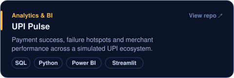</a>
  <a href="https://github.com/abhi2326/ondc-360-open-commerce-network-analytics">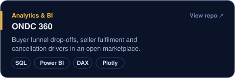</a>
</p>
<p align="center">
  <a href="https://github.com/abhi2326/ecommerce-sales-customer-analytics">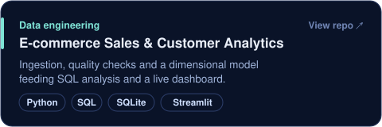</a>
  <a href="https://github.com/abhi2326/Sql-Query-Optimizer">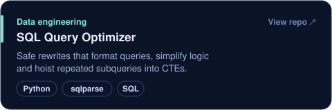</a>
</p>
<p align="center">
  <a href="https://github.com/abhi2326/credit-card-fraud-detection-advanced">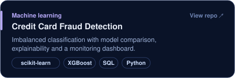</a>
  <a href="https://github.com/abhi2326/airaware-india-urban-air-quality-forecasting">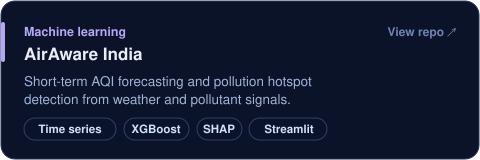</a>
</p>
<p align="center">
  <a href="https://github.com/abhi2326/Anticheating_detector">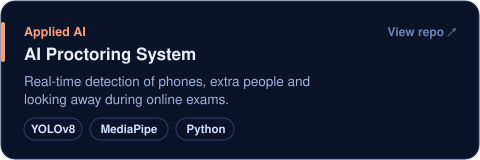</a>
  <a href="https://github.com/abhi2326/LLM_From_Scratch">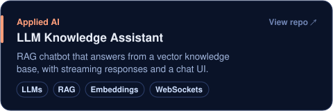</a>
</p>

<details>
<summary><b>More projects</b></summary>
<br/>

| Project | What it does | Stack |
|---|---|---|
| [MSME CashFlow IQ](https://github.com/abhi2326/msme-cashflow-iq-gst-invoice-intelligence) | Invoice ageing, overdue receivables and working-capital risk for MSMEs | SQL, Python, Power BI, DAX |
| [D2C RetentionOS](https://github.com/abhi2326/d2c-retentionos-consumer-growth-analytics) | Ties acquisition spend to cohorts, repeat purchases and contribution margin | SQL, Excel, Power BI, DAX |
| [ChargeGrid India](https://github.com/abhi2326/chargegrid-india-ev-infrastructure-intelligence) | EV charger utilisation, uptime and expansion opportunities | SQL, Python, Power BI, Plotly |
| [AI Resume Screening Tool](https://github.com/abhi2326/Resume-Screening-Tool) | Parses resumes and ranks candidates against job requirements | Python, NLP, ML |
| [AI Trading Agent](https://github.com/abhi2326/Building-an-AI-Agent-Autonomous-trading-decisions) | Reinforcement-learning agent that makes autonomous trading decisions | Python, RL |
| [Workout Counter](https://github.com/abhi2326/Workout-Counter) | Counts workout reps in real time from your webcam using pose detection | Python, Computer vision |
| [Gesture Control Calculator](https://github.com/abhi2326/Gesture-Control-Calculator) | Touch-free calculator controlled by hand gestures | OpenCV, MediaPipe |
| [Portfolio](https://github.com/abhi2326/Portfolio_Abhijeet) | My personal portfolio website | HTML, CSS, JavaScript |

</details>

<br/>

## GitHub analytics

<!-- These cards are generated inside this repo by .github/workflows/summary-cards.yml -->
<p align="center">
  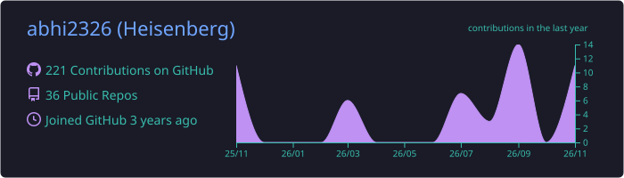
</p>
<p align="center">
  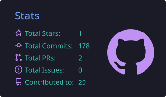
  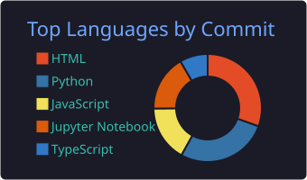
</p>

<p align="center">
  
</p>

<br/>

## Problem solving

<p align="center">
  <a href="https://leetcode.com/xpredatorx"></a>
  <a href="https://www.hackerrank.com/abhijeetmanas121"></a>
  <a href="https://www.codechef.com/users/predatorx"></a>
  <a href="https://www.geeksforgeeks.org/user/abhijeetmbvxp/"></a>
</p>

<br/>

## Let's connect

I'm always happy to talk about analytics, data engineering or a project you're building.

<p align="center">
  <a href="https://www.linkedin.com/in/abhijeet-sri11"></a>
  <a href="https://twitter.com/abhijeet_2709"></a>
  <a href="https://www.youtube.com/@YOUR_CHANNEL"></a>
  <a href="https://instagram.com/_justnowabhi_"></a>
  <a href="mailto:abhijeet.sri11@gmail.com"></a>
</p>

<br/>

<!-- Needs .github/workflows/snake.yml in this repo -->
<p align="center">
  <picture>
    <source media="(prefers-color-scheme: dark)" srcset="https://raw.githubusercontent.com/abhi2326/abhi2326/output/github-contribution-grid-snake-dark.svg" />
    <source media="(prefers-color-scheme: light)" srcset="https://raw.githubusercontent.com/abhi2326/abhi2326/output/github-contribution-grid-snake.svg" />
    
  </picture>
</p>

<p align="center"><i>"Without data, you're just another person with an opinion." — W. Edwards Deming</i></p>

<p align="center">
  
</p>
